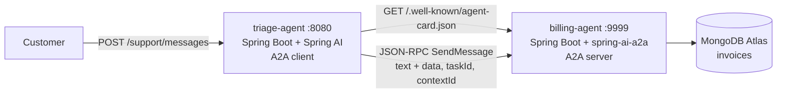
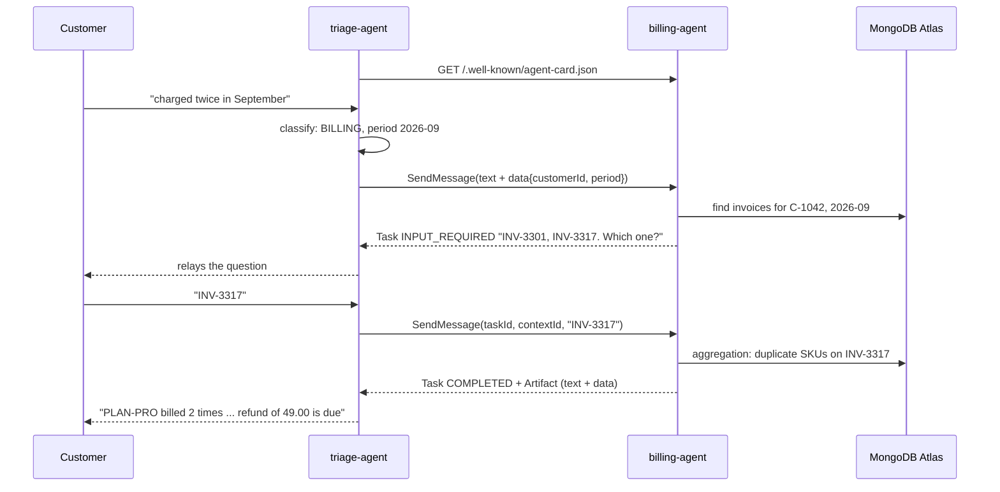

# support-agents: two agents talking over A2A

Companion code for the article *Two Agents Are Better Than One: Agent-to-Agent Communication with A2A*.

A **triage agent** receives customer messages, classifies them, and delegates billing questions to a **billing agent** over the [A2A protocol](https://a2a-protocol.org/latest/specification/) (version 1.0, JSON-RPC binding). The billing agent owns its data in MongoDB Atlas and never exposes it: the triage agent only sees the task lifecycle and the final artifact.



## What the demo shows

| A2A concept | Where |
|---|---|
| Discovery through the Agent Card | `BillingAgentCardConfig` publishes it; `BillingAgentClient` resolves it on first use |
| Structured context handoff (`text` part + `data` part) | `BillingAgentClient.delegate` |
| Task lifecycle driven by the server | `BillingAgentExecutor`: `submit` → `startWork` → `requiresInput` / `reject` / `addArtifact` + `complete` |
| `INPUT_REQUIRED` and multi-turn on the same `taskId` / `contextId` | `SupportController` keeps the pending `Handoff`; `BillingAgentClient.resume` continues the task |
| Context recovered from task history, not shared memory | `BillingRequest.from` reads the original `data` part from `Task.history` |
| Opaque specialist | `InvoiceQueries` runs an aggregation pipeline the caller never sees |

## Stack

| Component | Version |
|---|---|
| Java | 21 (built and tested with JDK 25) |
| Spring Boot | 4.1.2 |
| Spring AI | 2.0.2 (Anthropic starter, triage classification only) |
| spring-ai-a2a-server-autoconfigure | 0.4.0 |
| A2A Java SDK | 1.4.0.Final |
| MongoDB | Atlas cluster |

## Run it

### 1. Configure MongoDB Atlas

Credentials never go in `src/main/resources`. Each agent imports an optional `config/secrets.yml` from its module folder (ignored by git), whether you start it from the module folder or from the `support-agents` root. Values in `secrets.yml` take precedence over the environment-variable fallbacks.

`billing-agent/config/secrets.yml`:

```yaml
spring:
  mongodb:
    uri: mongodb+srv://<user>:<password>@<cluster>.mongodb.net/
    database: billing-agent
```

Alternatively, without the file, export `MONGODB_URI` (and optionally `MONGODB_DATABASE`, default `billing-agent`).

On first start the billing agent seeds three placeholder invoices if the `invoices` collection is empty.

Make sure your IP is in the Atlas network access list.

### 2. Build

```powershell
mvn -DskipTests package
```

### 3. Start the billing agent (A2A server)

```powershell
java -jar billing-agent/target/billing-agent-1.0.0-SNAPSHOT.jar
```

### 4. Start the triage agent (A2A client)

With an LLM (Spring AI ChatClient, structured output), put the key in `triage-agent/config/secrets.yml`:

```yaml
spring:
  ai:
    anthropic:
      api-key: <your key>
```

or export `ANTHROPIC_API_KEY`, then:

```powershell
java -jar triage-agent/target/triage-agent-1.0.0-SNAPSHOT.jar
```

The model defaults to `claude-opus-5-5`; override it with `TRIAGE_MODEL`.

Without an API key, the `offline` profile swaps the LLM for a keyword classifier. The A2A exchange is identical:

```powershell
java -jar triage-agent/target/triage-agent-1.0.0-SNAPSHOT.jar --spring.profiles.active=offline
```

### 5. Run the conversation

```powershell
./demo.ps1
```

Or by hand:

```powershell
curl -s -X POST http://localhost:8080/support/messages -H "Content-Type: application/json" `
  -d '{"sessionId":"s1","customerId":"C-1042","text":"I think I was charged twice in September"}'
curl -s -X POST http://localhost:8080/support/messages -H "Content-Type: application/json" `
  -d '{"sessionId":"s1","customerId":"C-1042","text":"INV-3317"}'
```

Expected flow:



## Talk to the billing agent directly

The billing agent is a plain A2A server, so any A2A client can call it. Raw JSON-RPC (note the `A2A-Version` header, without it spring-ai-a2a treats the call as protocol 0.3):

```powershell
curl -s -X POST http://localhost:9999/ -H "Content-Type: application/json" -H "A2A-Version: 1.0" -d '{
  "jsonrpc": "2.0", "id": "1", "method": "SendMessage",
  "params": { "message": {
    "messageId": "m-1", "role": "ROLE_USER",
    "parts": [
      { "text": "Customer reports a duplicate charge" },
      { "data": { "customerId": "C-1042", "period": "2026-09" } }
    ] } } }'
```

## Tests

```powershell
mvn test
```

No database or API key needed:

- `BillingAgentA2ATest` starts the billing agent as a real A2A server and calls it with the real A2A Java client over JSON-RPC. Only `InvoiceQueries` is mocked. It checks the Agent Card, the `INPUT_REQUIRED` → `COMPLETED` round trip on the same `taskId` / `contextId`, the artifact content, and the rejection of a handoff without structured context.
- `TriageAgentOfflineTest` starts the triage agent with the `offline` profile and checks the classification.

## Things the SDKs do that you may not expect

- **spring-ai-a2a needs `spring-ai-client-chat` on the classpath.** The dependency is optional in its POM, and the auto-configuration is `@ConditionalOnClass(ChatClient.class)`. Without it the A2A endpoints are not registered and every call returns 404. The billing agent declares it explicitly even though it uses no chat model.
- **The A2A Java SDK is fail-closed on task access.** Without a `TaskAuthorizationProvider` bean every task operation is denied and reported as `TaskNotFoundError`, so that callers cannot probe which task ids exist. The demo sets `a2a.authorization.required=false`. A production agent authenticates the caller and provides a provider.
- **`AgentEmitter.submit()` creates a task with an empty history.** To keep the caller's first message (and its `data` part) available on later turns, `BillingAgentExecutor` creates the task with `emitter.addTask(...)` and puts `context.getMessage()` in the history.
- **Do not import `a2a-java-sdk-bom` next to Spring AI.** It inherits a `dependencyManagement` entry that puts `okhttp` in `test` scope, and the Anthropic client used by Spring AI then fails at startup with `NoClassDefFoundError: okhttp3/Callback`. This project pins the A2A client artifacts by version instead.
- **spring-ai-a2a advertises a second interface.** For each `JSONRPC` interface on the card it adds a copy with `protocolVersion: "0.3"`. Both point to the same URL, and the controller dispatches on the `A2A-Version` header.

## Limits

- The triage agent keeps pending handoffs in memory, and spring-ai-a2a uses an in-memory task store. Restarting either agent loses in-flight tasks.
- spring-ai-a2a 0.4.0 serves JSON-RPC only, without SSE streaming, so the card declares `streaming: false` and every `SendMessage` blocks until the task is terminal or interrupted.
- No authentication between agents. A production setup declares a security scheme on the Agent Card (OAuth2 client credentials or mTLS) and enforces it on the JSON-RPC endpoint.
- Invoice data is placeholder data seeded by `SampleInvoices`.
